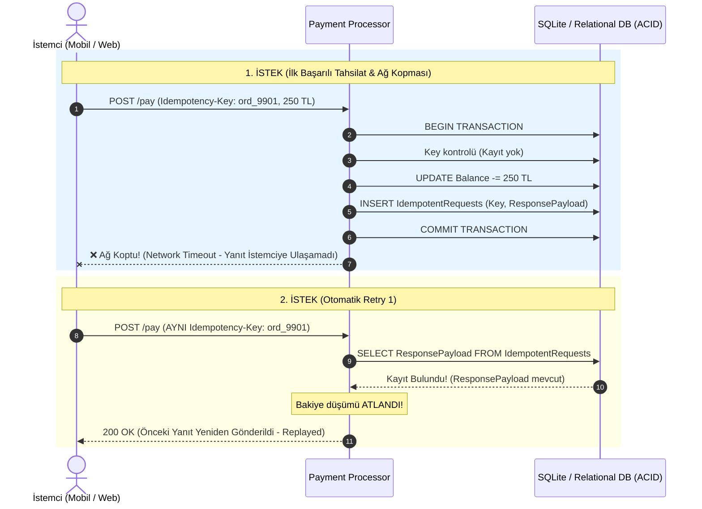

# Transactional Idempotency & Retry Pattern in C# .NET


Bu repo, fintech, bankacılık ve ödeme altyapılarında (Stripe, Adyen, PayPal vb.) **Ağ Zaman Aşımları (Network Timeout) ve Otomatik Yeniden Denemeler (Retry)** nedeniyle oluşabilecek **Mükerrer Tahsilat (Double-Charging)** felaketini ve bu problemin **Transactional Idempotency** deseniyle nasıl kesin olarak çözüldüğünü gösteren uygulamalı bir projedir.

---

## 📌 Problem: Bakiye Kontrolü Mükerrer Çekimi Neden Tek Başına Önleyemez?

Eşzamanlılık (Concurrency) kontrolleri, bakiyenin yetersiz olduğu durumlarda hesabın eksiye düşmesini engeller. **Fakat kullanıcının yeterli bakiyesi varsa ve ağ koparsa ne olur?**

1. Kullanıcının bakiyesi **1.000 TL** olsun.
2. 250 TL'lik bir sipariş için ödeme isteği atılır.
3. Sunucu veritabanında 250 TL'yi başarıyla çeker (Yeni bakiye: 750 TL).
4. **Kritik Hata (Network Drop / Timeout):** Tam `200 OK` yanıtı istemciye dönerken bağlantı kopar veya zaman aşımı gerçekleşir.
5. İstemci (mobil uygulama / frontend / background worker) işlemin başarısız olduğunu varsayarak **isteği 3 kez daha yeniden dener (Retry)**.
6. Hesapta hala yeterli bakiye (750 TL) olduğu için geleneksel sistem her denemede 250 TL daha çeker!
7. **Sonuç:** Kullanıcı 250 TL'lik tek bir ürün için **1.000 TL ödemiş olur ve kasadaki 4 ayrı işlem kaydıyla mağdur edilir.**

---

## 🛡️ Çözüm: Transactional Idempotency

İstemci her ödeme emriyle birlikte benzersiz bir **`Idempotency-Key`** gönderir.
Ödeme motoru; **bakiye düşümü, işlem dekontu (ledger) ve idempotency kaydını AYNI ACID Transaction** içinde işler:

```sql
BEGIN TRANSACTION;

-- 1. Idempotency Key kontrol edilir
SELECT ResponsePayload FROM IdempotentRequests WHERE IdempotencyKey = @Key;

-- 2. Eğer varsa: Bakiye düşülmeden önceki yanıt doğrudan döndürülür (Replayed)!
-- 3. Eğer yoksa: Bakiye düşülür, dekont yazılır ve IdempotentRequests tablosuna kaydedilir.

COMMIT;
```

---

## 🔄 Mimari Akış Şeması (Mermaid Sequence Diagram)



---

## 🚀 Nasıl Çalıştırılır?

```bash
git clone https://github.com/EmreSlgr/dotnet-transactional-idempotency.git
cd dotnet-transactional-idempotency
dotnet run
```

### Beklenen Konsol Çıktısı

```text
==========================================================================
  TRANSACTIONAL IDEMPOTENCY & RETRY (MÜKERRER TAHSİLAT KORUMASI)
==========================================================================

>>> 1. SENARYO: Idempotency Koruması Olmayan Standart Ödeme Motoru
  [Başlangıç] Bakiye: 1000 TL | Sipariş Tutarı: 250 TL

  [İstek #1] DB'de çekim yapıldı ama İSTEMCİDE TIMEOUT OLDU! İstemci tekrar deniyor...
  [İstek #2] DB'de çekim yapıldı ama İSTEMCİDE TIMEOUT OLDU! İstemci tekrar deniyor...
  [İstek #3] DB'de çekim yapıldı ama İSTEMCİDE TIMEOUT OLDU! İstemci tekrar deniyor...
  [İstek #4] Sonunda istemciye yanıt ulaştı: 200 OK!

  [FELAKET SENARYOSU - MÜKERRER TAHSİLAT (OVERCHARGED)]
  * Başlangıç Bakiyesi       : 1.000 TL
  * Yapılması Gereken Çekim  : 250 TL (Tek bir sipariş)
  * Gerçekte Çekilen Tutar   : 1000 TL (4 defa x 250 TL)
  * Kalan Bakiye             : 0 TL
  * Veritabanı İşlem Kaydı   : 4 adet
  * SONUÇ                    : Kullanıcı tek sipariş için 4 kez ücretlendirildi!

--------------------------------------------------------------------------

>>> 2. SENARYO: Transactional Idempotency Korumalı Ödeme Motoru
  [Başlangıç] Bakiye: 1000 TL | Idempotency Key: idemp_key_alice_ord_9901

  [İstek #1] İlk ödeme ACID Transaction ile işlendi. (Bakiye: 750 TL)
             Yanıt istemciye dönerken AĞ KOPTU (Timeout). İstemci tekrar deniyor...
  [İstek #2 - RETRY] Idempotency Key yakalandı! Bakiye düşülmedi, kayıtlı yanıt döndü: 200 OK (Replayed)
  [İstek #3 - RETRY] Idempotency Key yakalandı! Bakiye düşülmedi, kayıtlı yanıt döndü: 200 OK (Replayed)
  [İstek #4 - RETRY] Idempotency Key yakalandı! Bakiye düşülmedi, kayıtlı yanıt döndü: 200 OK (Replayed)

  [KUSURSUZ GÜVENLİK - IDEMPOTENCY SUCCESS]
  * Başlangıç Bakiyesi       : 1.000 TL
  * Yapılması Gereken Çekim  : 250 TL
  * Gerçekte Çekilen Tutar   : 250 TL
  * Kalan Bakiye             : 750 TL (Kusursuz korundu)
  * Veritabanı İşlem Kaydı   : 1 adet (Yalnızca 1 kayıt)
  * SONUÇ                    : 4 denemeye rağmen tek bir tahsilat yapıldı.
```

---

## 💡 Kurumsal Sistemlerde Üretim (Production) Notları

1. **Transaction İzolasyonu:** Idempotency anahtarı ile bakiye düşümünün aynı transaction içinde olması, işlemin bölünmezliğini (Atomicity) garanti eder.
2. **TTL (Time-To-Live):** Idempotency kayıtları sonsuza dek saklanmaz; Stripe standartlarına göre genellikle 24 ile 48 saat arasında bir geçerlilik süresine sahiptir.
3. **Eşzamanlı Çakışmalar (In-Flight Requests):** Aynı key ile aynı anda iki istek gelirse, veritabanındaki `PRIMARY KEY` kısıtı ikinci isteğe `409 Conflict` veya bekleme kilidi uygulayarak race condition'ı engeller.

---

## 👨‍💻 Geliştirici
* **Emre Salgır** - [GitHub Profilim](https://github.com/EmreSlgr)
